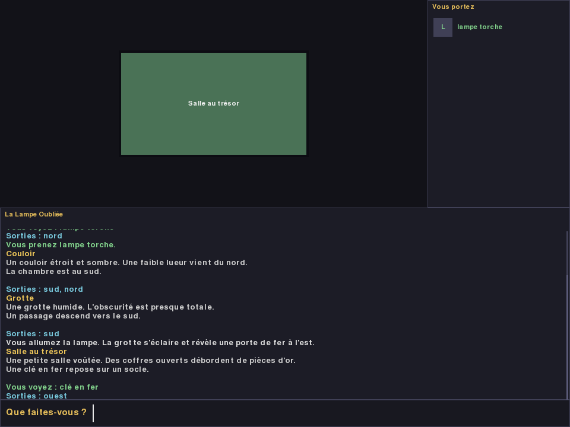
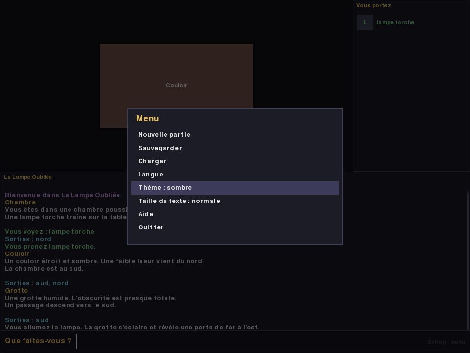
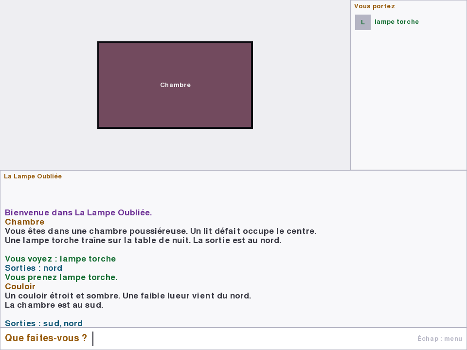
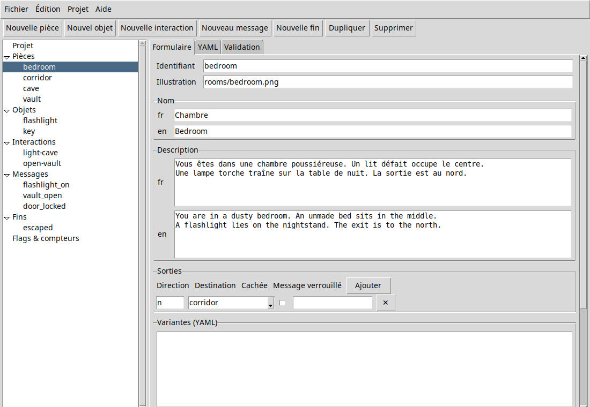
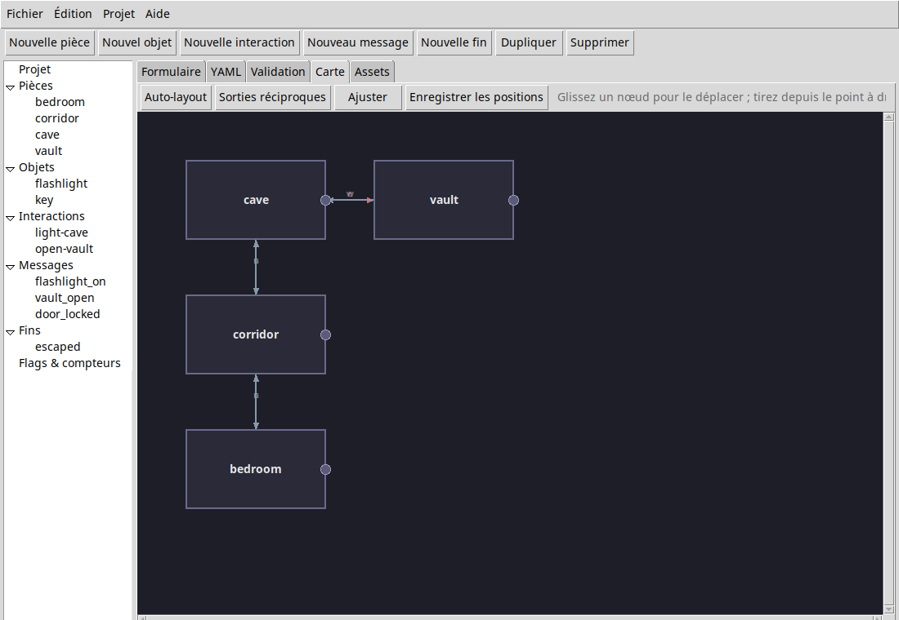

# PyVenture

Un moteur d'aventure texte à l'ancienne, dans l'esprit de Zork, avec des illustrations **pixel art** au-dessus du texte et un **éditeur graphique** de contenu.

> Projet en cours de refonte. Le moteur historique reste jouable et sert de référence.

## État actuel

- ✅ Moteur texte historique fonctionnel (`start.py`).
- ✅ Cadrage terminé : architecture, format de données, roadmap, éditeur et i18n documentés.
- ✅ **Nouveau moteur data-driven** : chargement YAML, parseur multilingue, interactions déclaratives, sauvegarde, mode terminal.
- ✅ Projet d'exemple jouable en FR et EN (`examples/mini-game`).
- ✅ **Fenêtre pygame** : art pixel art, transcript, inventaire, saisie, menu, thème clair/sombre, transitions.
- ✅ **Éditeur Tkinter** : pièces, objets, interactions, messages, fins, validation, YAML, undo/redo, duplication, vue carte, assets, aperçu.

**Décisions clés** : pygame-ce pour le jeu (320×180), Tkinter/ttk pour l'éditeur, YAML + schéma JSON pour le contenu, FR/EN, Linux d'abord, licence MIT.

## Jouer

```bash
# Nouveau moteur (recommandé)
python3 -m pyventure play                       # projet d'exemple, en français
python3 -m pyventure play --gui                 # fenêtre pygame (art + texte)
python3 -m pyventure play --lang en             # en anglais
python3 -m pyventure play -p mon-jeu/game.yaml  # un projet précis
python3 -m pyventure play --fresh               # ignorer la reprise automatique

# Contenu historique converti en YAML
python3 -m pyventure play -p examples/legacy-game/game.yaml

# Moteur historique d'origine (référence)
python3 start.py
python3 -m pyventure play --legacy
```

Sur certains systèmes, la commande est `python` au lieu de `python3`.

La partie est **sauvegardée automatiquement** après chaque tour et reprise au lancement. `--fresh` repart de zéro, `--no-autosave` désactive la sauvegarde automatique.

La fenêtre graphique nécessite pygame : `pip install -e ".[gui]"`. Le mode terminal n'en a pas besoin.







Dans la fenêtre : `Échap` ouvre le menu, `Tab` complète, `↑`/`↓` parcourt l'historique, la molette et `PageUp`/`PageDown` font défiler le texte.

Commandes : `regarder`, `prendre <objet>`, `lâcher <objet>`, `utiliser <objet>`, `examiner <objet>`, `inventaire`, `score`, directions (`n/s/e/w/u/d`, `nord`…), `sauvegarder`, `charger`, `annuler`, `langue en`, `quitter`. En anglais : `look`, `take`, `drop`, `use`, `examine`, `inventory`, `score`, `north`…

## Éditer le contenu

L'éditeur graphique (Tkinter) permet de créer et modifier pièces, objets, interactions, messages et fins, sans écrire de YAML.

```bash
sudo apt install python3-tk        # paquet système requis (Linux)
python3 -m pyventure editor
python3 -m pyventure editor examples/mini-game/game.yaml
```



Il propose un arbre de projet, des formulaires par langue, un éditeur de sorties, un onglet YAML synchronisé, la validation en continu avec navigation, undo/redo, duplication, projets récents, hot reload et un bouton pour lancer le jeu.

Onglet **Carte** : nœuds de pièces déplaçables, flèches de sorties colorées selon les conditions, création de sortie par glisser-déposer, sorties réciproques en un clic, auto-layout et miniatures d'art.



Onglet **Assets** : statut de chaque illustration (manquante, dimensions incorrectes), aperçu, import/remplacement, génération de placeholders et rapport des fichiers inutilisés.

## Objectifs

1. **Conserver le jeu texte** : parser, descriptions, énigmes, mode terminal.
2. **Ajouter une fenêtre pixel art** au-dessus du transcript, dans une même fenêtre.
3. **Fournir un éditeur GUI** pour les pièces, objets, descriptions et interactions.
4. **Rendre le jeu multilingue** sans toucher au code.

## Documentation

| Document | Contenu |
| --- | --- |
| [Audit et propositions](docs/00-audit-propositions.md) | État des lieux, bugs, idées, décisions validées |
| [Architecture](docs/01-architecture.md) | Organisation du code et flux d'exécution |
| [Modèle de données](docs/02-modele-de-donnees.md) | Format YAML des pièces, objets, interactions |
| [Roadmap](docs/03-roadmap.md) | Phases, tâches et critères de sortie |
| [Éditeur](docs/04-editeur.md) | Spécifications de l'éditeur graphique |
| [Multilingue](docs/05-i18n.md) | Stratégie de traduction |
| [Workflow](docs/06-workflow-dev.md) | Installation, tests, conventions |

## Installation

```bash
python3 -m venv .venv
source .venv/bin/activate
python -m pip install -e ".[dev,gui]"
```

Sur Debian/Ubuntu récents, le Python système refuse `pip install` (PEP 668) : passez par l'environnement virtuel ci-dessus. Pour jouer seulement, `pip install -e .` suffit ; `[gui]` ajoute pygame, `[dev]` les outils de test.

```bash
python3 -m pyventure play          # terminal (Phase 1)
python3 -m pyventure play --gui    # fenêtre pygame (Phase 2+)
python3 -m pyventure editor        # éditeur Tkinter (Phase 3+)
python3 -m pyventure validate examples/mini-game/game.yaml
```

L'éditeur nécessite `python3-tk` (paquet système sur Linux). Le jeu et le mode terminal n'en ont pas besoin.

## Tests et qualité

```bash
pytest                 # suite complète (58 tests)
pytest tests/golden    # transcripts de référence
UPDATE_GOLDEN=1 pytest tests/golden   # régénérer les transcripts
ruff check .           # lint
ruff format .          # formatage
make test              # raccourcis Makefile
```

## Structure

```text
pyventure/
├── core/       # moteur pur, sans interface
├── ui/         # terminal et pygame
├── editor/     # éditeur Tkinter
├── schema/     # schéma JSON du format
└── locales/    # chaînes d'interface
examples/       # projets d'exemple
docs/           # spécifications et roadmap
tests/          # tests unitaires, golden et UI
tools/          # migration et maintenance
```

## Exemples

- [`examples/mini-game`](examples/mini-game/game.yaml) : projet de référence, 4 pièces, 2 objets, 2 interactions, FR/EN. Jouable de bout en bout.
- [`examples/legacy-game`](examples/legacy-game/game.yaml) : contenu historique converti depuis `content.py` par [`tools/convert_legacy.py`](tools/convert_legacy.py).

```bash
python3 -m pyventure play -p examples/mini-game/game.yaml
python3 -m pyventure play -p examples/legacy-game/game.yaml
```

## Développement

Le cœur (`pyventure/core/`) est pur : aucune dépendance graphique. Le terminal (`pyventure/ui/terminal/`) et, à venir, pygame (`pyventure/ui/pygame/`) ne font que le rendu. Voir [`docs/01-architecture.md`](docs/01-architecture.md).

Commandes de debug en jeu : `/goto <pièce>`, `/give <objet>`, `/flags`, `/state`.

## Contribution

Lire [`CONTRIBUTING.md`](CONTRIBUTING.md) et le [workflow de développement](docs/06-workflow-dev.md).

## Plateformes

Linux est la cible principale. Le cœur pur Python, le rendu logiciel de pygame et le mode terminal gardent la porte ouverte à des portages vers des machines rétro.

## Licence

Distribué sous [licence MIT](LICENSE).
